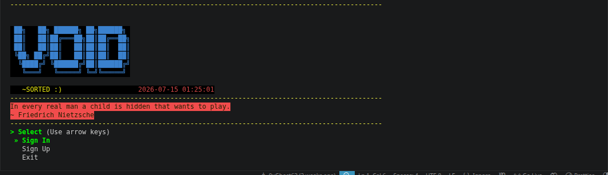
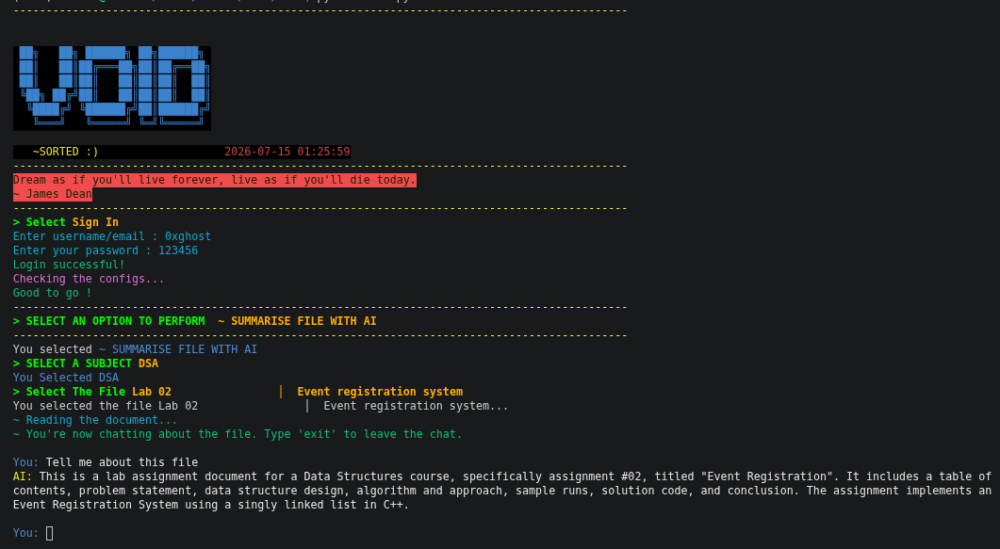

# VOID

A terminal-first workspace for managing your study files, straight from the command line. No browser tabs, no clutter — just you, your files, and a terminal that looks like it belongs in a hacker movie.

VOID lets you upload your notes, PDFs, and assignments to the cloud, organize them by subject, pull them back down whenever you need them, and even chat with an AI about the contents of a file to get quick summaries or answers. It's built for people who'd rather live in the terminal than dig through folders and cloud dashboards.

## What VOID actually does

- **Upload & store files** — push your notes and PDFs to secure cloud storage, tagged and sorted by subject
- **Download anytime** — pull a file back down directly to your machine, or grab a shareable link for it instead
- **AI-powered summaries** — VOID reads through your PDFs and hands you back a structured breakdown of what's inside, so you don't have to skim the whole thing yourself
- **Chat with your files** — ask questions about a specific file and get answers grounded in its actual content, not generic guesses
- **Delete cleanly** — remove files from both storage and your records in one go, with a confirmation step so nothing goes missing by accident
- **Account system** — your files are tied to your account and synced across every machine you run VOID on, so switching devices doesn't mean starting over
- **Subject-based organization** — set up your enrolled subjects once (stored per-account in the cloud), and everything you upload gets sorted under them automatically
- **Your storage, everywhere** — keep every file in VOID Cloud and optionally a local folder, Google Drive, and/or a GitHub repository, all mirrored automatically
- **Local dashboard** — a dark, terminal-flavoured web UI at `http://127.0.0.1:8000` for browsing, uploading, syncing, and downloading without leaving the browser

<br>



<br>



<br>

## Installation

You only need [Python 3.10+](https://www.python.org/downloads/) and a network connection. **Git is not required** — the installer pulls a zip of `main` from GitHub and walks you through a progress bar while it works.

### Linux / macOS

```bash
curl -fsSL https://raw.githubusercontent.com/0xGhost63/VOID/main/scripts/install.sh | bash
```

### Windows

```powershell
irm https://raw.githubusercontent.com/0xGhost63/VOID/main/scripts/install.ps1 | iex
```

What the installer does:

1. Downloads VOID as a zip into `~/.void-cli` (Windows: `%USERPROFILE%\.void-cli`)
2. Writes `.env` from `.env.example` (public Supabase + API URL only — no secret AI keys on your machine)
3. Builds a local Python `venv` and installs dependencies
4. Drops a `void` command on your PATH

If `void` isn't found right away, open a new terminal (PATH refresh).


### Uninstall

**Linux / macOS**
```bash
rm -rf ~/.void-cli && rm -f ~/.local/bin/void
```

**Windows (PowerShell)**
```powershell
Remove-Item -Recurse -Force "$env:USERPROFILE\.void-cli" -ErrorAction SilentlyContinue
Remove-Item -Force "$env:USERPROFILE\.void-bin\void.cmd" -ErrorAction SilentlyContinue
```

### Manual install (from a zip, still no git)

```bash
curl -fsSL -o void.zip https://github.com/0xGhost63/VOID/archive/refs/heads/main.zip
unzip void.zip && cd VOID-main
cp .env.example .env
python3 -m venv venv
source venv/bin/activate      # Windows: venv\Scripts\activate
pip install -r requirements.txt
python main.py
```

### Running it

```bash
void
```

anywhere. First run: sign in (or register), set subjects if the account is new, then use the main menu.

### Local dashboard

From a checkout of the repo, run:

```bash
./run
```

Then open **http://127.0.0.1:8000**. `./run` uses `.venv`, `venv`, or `python3`, and the port can be changed with `PORT=8080 ./run` or `./run --port 8080`.

The dashboard shows every document, its subject, which places hold a copy, and the sync state. From there you can upload a file, download a copy, delete a document, and press **Sync Now** to reconcile every connected place. It reads the same local catalog as the terminal app, so changes made in either one show up in the other.

### Storage places

Open **Settings → Storage** in the terminal app. VOID Cloud is always on; you can add:

- **Local folder** — a directory on this machine. Files are stored as `SUBJECT/filename`.
- **Google Drive** — authorize once with Google's device flow. VOID creates a `VOID` folder and stores files as `SUBJECT/filename` inside it.
- **GitHub** — a fine-grained personal access token with **Contents: Read and write** on one repository. Files go under `VOID/SUBJECT/filename`, and the rest of the repo is untouched.

Once a place is connected, it is kept in sync automatically: new uploads are written to every place, existing files are mirrored on the next sync, and edits or deletes propagate both ways. If a place is offline, the change is queued and retried later. If two places hold different versions of the same file, VOID keeps both by saving a `(conflict …)` copy instead of overwriting either one.

Disconnecting a place never deletes the files it already holds.

## Using VOID

Once you're logged in, everything happens through the main menu. Use the arrow keys to move between options and Enter to select:

- **Upload File** — pick a file from your system, tag it with a subject (and edit tags manually if it's handwritten notes), and it gets stored
- **Download File** — browse your uploaded files by subject, then either download the file directly or grab a shareable link for it
- **Summarise File with AI** — select a file and VOID reads through it, figures out what kind of document it is, and hands you back a clean summary
- **Delete File** — pick a file to remove permanently; you'll be asked to confirm before anything actually gets deleted
- **Settings** — manage your enrolled subjects and connect storage places (local folder, Google Drive, GitHub)

Every menu in VOID works the same way, so once you've navigated one, you already know how to use the rest of them.

## Troubleshooting

- **`curl: (22) The requested URL returned error: 404`** — installer isn't on GitHub `main` yet, or wrong path. Use the repo-root URLs above (`.../main/install.sh`), not `scripts/`.
- **`void: command not found`** — new terminal, or add `export PATH="$HOME/.local/bin:$PATH"` to `~/.bashrc` / `~/.zshrc`.
- **`ensurepip` / `venv` errors on Linux** — `sudo apt install python3-venv`, then re-run the installer.
- **Download / unpack fails** — need `curl` or `wget`, plus working internet to GitHub.
- **Login fails repeatedly** — check connectivity to Supabase; confirm `.env` exists under `~/.void-cli` (re-run installer to recreate from `.env.example`).
- **AI summarise / chat fails** — those go through the hosted VOID web backend; stay logged in and online.
- **Windows Defender flags the install script** — common false positive for remote PowerShell. Inspect [`install.ps1`](https://github.com/0xGhost63/VOID/blob/main/install.ps1) before running if you want.

## Prefer not to install anything?

VOID also has a full web version, available at:

**[0xghost-void.vercel.app](https://0xghost-void.vercel.app/)**

It's a browser-based rebuild of VOID on FastAPI and Supabase, with AI-assisted uploads that auto-tag your PDFs by subject and type, per-file chat, a dashboard with usage stats, and a one-click export of all your data as a zip. Subjects are stored per-account in Supabase and are shared with the CLI for the same login — so what you set in Settings on either side stays in sync. It's a solid option if you're on a machine you don't want to install anything on, or just want to try VOID out before committing to the terminal version.

## Built with

Python, Supabase (auth + storage + per-user subjects), and Groq / Gemini via the VOID web backend for AI — plus a terminal UI that doesn't take itself too seriously.

## License / credit

Built by [0xGhost63](https://github.com/0xGhost63).
